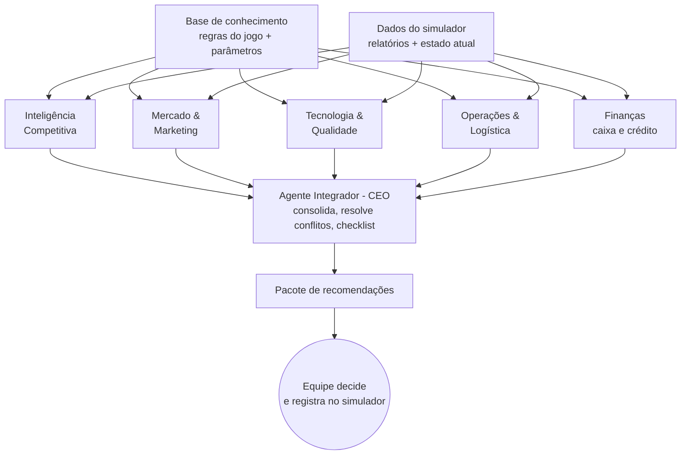
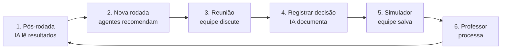

# Sistema multiagente de apoio à decisão para um business game de MBA

> Projeto do MBA IBMEC. Usa agentes de IA (Claude) para apoiar uma equipe nas decisões trimestrais do simulador empresarial **TecTrain Business Management**.

  

## O problema
Em um business game, cada equipe dirige uma empresa simulada e, a cada rodada (trimestre), decide **dezenas de variáveis interligadas**: preço, força de vendas, propaganda, produção, capacidade, logística, P&D, qualidade e financiamento. As regras estão espalhadas num manual longo (com tabelas em imagem), os resultados chegam em vários relatórios PDF e as decisões têm **defasagens** (o que se produz hoje só vende no trimestre seguinte). É fácil errar por falta de visão integrada, sobretudo no caixa.

## A solução
Um **sistema multiagente** em que cada agente faz o papel de um diretor especialista, todos lendo a mesma **base de conhecimento**. Um agente **integrador (CEO)** consolida as recomendações, verifica a coerência entre as áreas e entrega à equipe um **pacote de decisões** no formato exato das telas do simulador.

> **Princípio central:** *os agentes recomendam, as pessoas decidem.* A IA analisa, calcula e justifica. A decisão final e o registro no simulador são sempre da equipe.



## Como funciona cada rodada

Ordem de execução dos agentes: **Inteligência Competitiva + Mercado** → **Tecnologia** → **Operações** (usa a demanda estimada) → **Finanças** (usa todos os custos e receitas e roda o modelo de caixa) → **CEO**.

## Por onde começar
1. [`entregaveis/Projeto_Agentico_Business_Game_Equipe3.pdf`](entregaveis/Projeto_Agentico_Business_Game_Equipe3.pdf): visão geral em 9 páginas, ou a [apresentação em PowerPoint](entregaveis/Projeto_Agentico_Business_Game_Equipe3.pptx) (12 slides).
2. [`rodadas/T2/T2_00_RECOMENDACAO_FINAL_CEO.md`](rodadas/T2/T2_00_RECOMENDACAO_FINAL_CEO.md): exemplo de saída do sistema.
3. [`harness/00_HARNESS_LEIA_PRIMEIRO.md`](harness/00_HARNESS_LEIA_PRIMEIRO.md): como o projeto é operado.

## Estrutura do repositório
```
base-conhecimento/   regras do jogo, parâmetros, telas, estado atual (fonte da verdade)
harness/             regras de operação, comandos, templates, persistência, modelo de simulação
rodadas/Tn/          saída dos agentes por trimestre
registro/            decisões, perguntas ao professor, lições aprendidas, changelog
docs/                arquitetura dos agentes e método da base de conhecimento
entregaveis/         PDF e PowerPoint de apresentação ao grupo + geradores
```

## Componentes
| Componente | O que é | Onde |
|---|---|---|
| **Base de conhecimento** | 11 documentos temáticos: regras do jogo, parâmetros, telas do simulador, estado atual da empresa, checklist | [`base-conhecimento/`](base-conhecimento/) (método em [`docs/base-de-conhecimento.md`](docs/base-de-conhecimento.md)) |
| **Agentes** | 6 papéis com missão, entradas, decisões, saídas e prompt | [`docs/arquitetura-agentes.md`](docs/arquitetura-agentes.md) |
| **Harness** | A camada de operação: regras, comandos, templates e protocolo de persistência, para que qualquer conversa se comporte igual e salve tudo | [`harness/`](harness/) |
| **Modelo de simulação** | Modelo em Python (sem dependências) de caixa e DRE do trimestre, com cenários | [`harness/04_modelo_simulacao.py`](harness/04_modelo_simulacao.py) |
| **Rodadas** | Saída dos agentes por trimestre (recomendações, decisão tomada, pós-rodada) | [`rodadas/`](rodadas/) |
| **Registros** | Log de decisões, perguntas ao professor, lições aprendidas, changelog | [`registro/`](registro/) |
| **Entregáveis** | Apresentação em PDF para o grupo e o script que a gera | [`entregaveis/`](entregaveis/) |

## O harness: transformar chats em um sistema
O maior risco de usar IA conversacional num projeto de vários meses é **perder contexto entre conversas**. O harness resolve isso com:
- **Comandos padronizados** (`/status`, `/nova-rodada T3`, `/simular`, `/registrar-decisao`, `/pos-rodada` …), cada um dizendo **o que ler, o que fazer e onde salvar**;
- **Templates obrigatórios**, para que as rodadas sejam comparáveis entre si;
- **Protocolo de persistência:** tudo que é durável (recomendação, decisão, número novo, lição) vira documento, com changelog;
- **Rastreabilidade:** todo número é marcado como `[manual]`, `[observado]`, `[análise]` ou `[premissa]`;
- **Ciclo de calibração:** a cada rodada, comparar o previsto com o realizado gera "lições aprendidas" que recalibram o modelo.

## Destaques do processo
- **Extração de conhecimento de fontes heterogêneas:** manual em PDF com tabelas como imagem (renderizadas e lidas), telas web do simulador e 10 relatórios PDF por rodada.
- **Descoberta de parâmetros ocultos:** valores que não estão no manual foram deduzidos por engenharia reversa dos relatórios (custo de estocagem, alíquota de imposto, custo unitário real da fábrica, taxa efetiva do empréstimo de emergência).
- **Detecção de inconsistências** no material oficial, transformadas numa lista de perguntas ao professor.
- **Insight-chave da primeira rodada:** o modelo mostrou que o gargalo era **caixa, e não lucro**. A empresa ficava perto do equilíbrio contábil, mas com caixa negativo sem financiamento. Isso mudou a pauta da equipe: de "qual preço?" para "como financiar a entrada no mercado?".

## Rodando o modelo
```bash
python3 harness/04_modelo_simulacao.py
```
Os parâmetros estão calibrados para o início do Trimestre 2 da Equipe 3. Atualize `PARAMETROS_ATUAIS` e `DEMANDA_MEDIA` a cada rodada (fonte: `base-conhecimento/08_estado_atual_equipe3.md`).

## Tecnologia
- **Claude Projects** (base de conhecimento compartilhada pela equipe e instruções do projeto)
- Agentes definidos por prompts estruturados e orquestrados pelo agente integrador
- **Python** para o modelo financeiro
- Markdown como formato único de conhecimento (versionável e legível por humanos e por IA)

## Limitações e próximos passos
- O manual não publica as funções de demanda (quanto cada vendedor ou real de propaganda gera de vendas). Elas serão **calibradas empiricamente** a cada rodada.
- Próximo: gerar automaticamente o quadro comparativo dos concorrentes a partir dos relatórios e medir a acurácia das previsões ao longo do jogo.

---
*Projeto acadêmico com empresa e dados fictícios. "TecTrain Business Management" é marca de TecTrain Consultoria Ltda.; o manual original do participante não está incluído neste repositório.*
